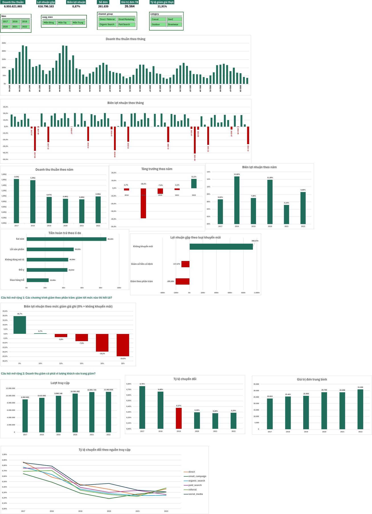
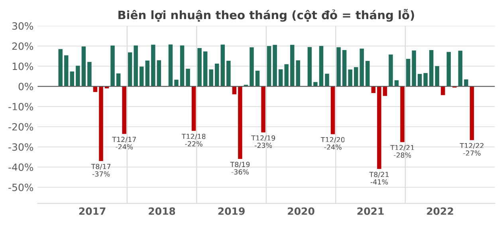
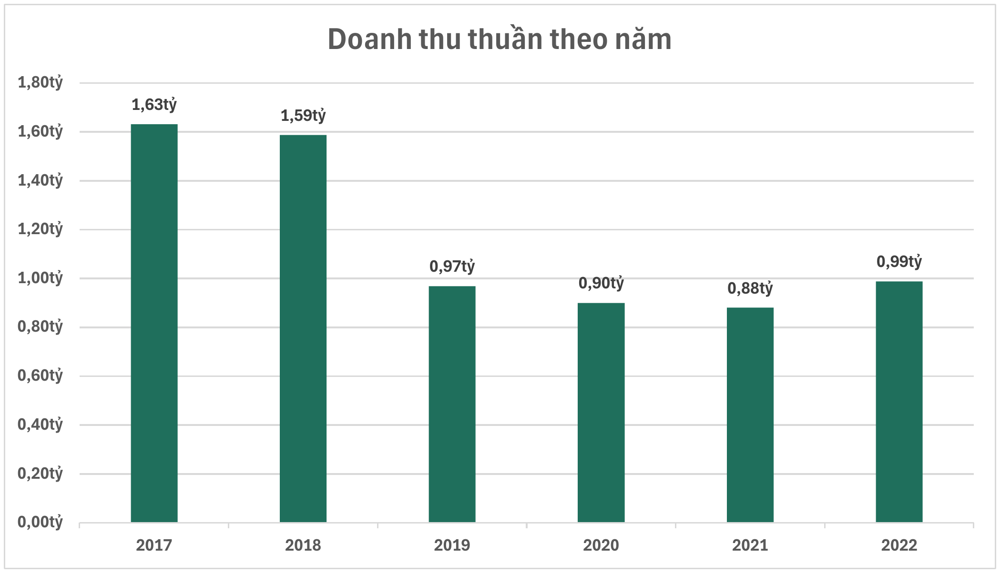
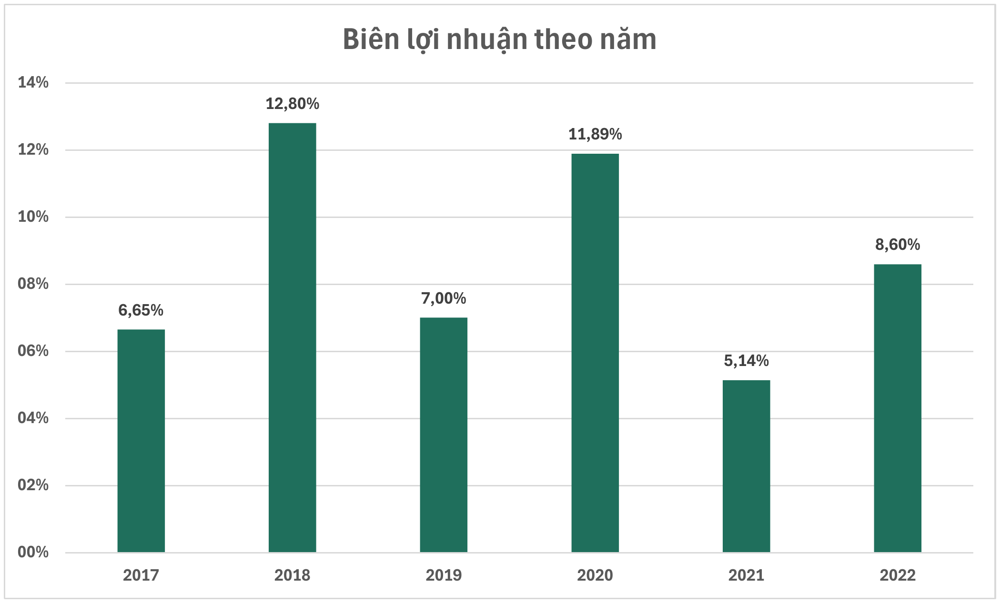
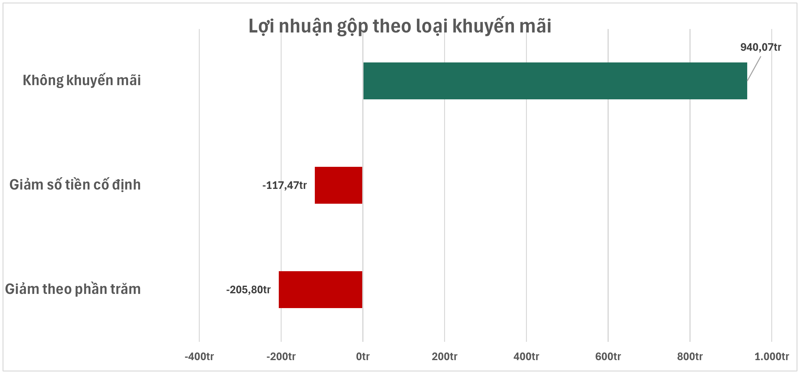
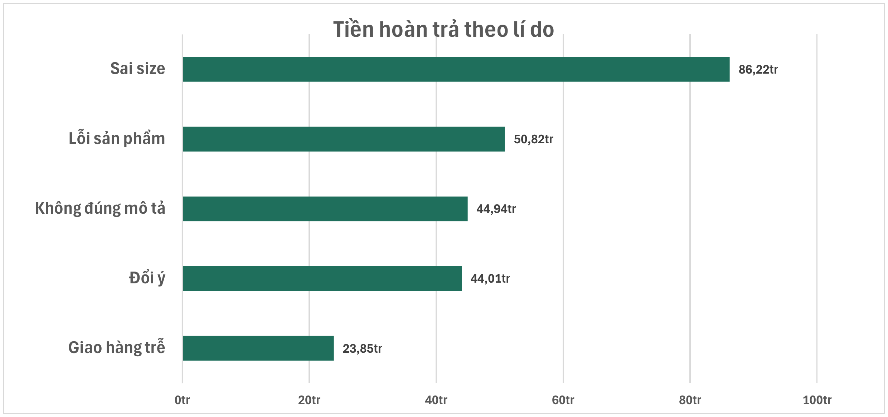
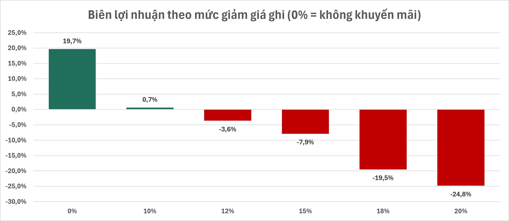
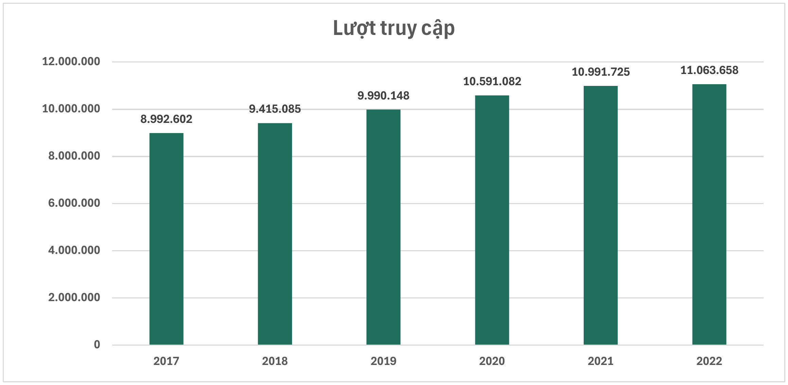
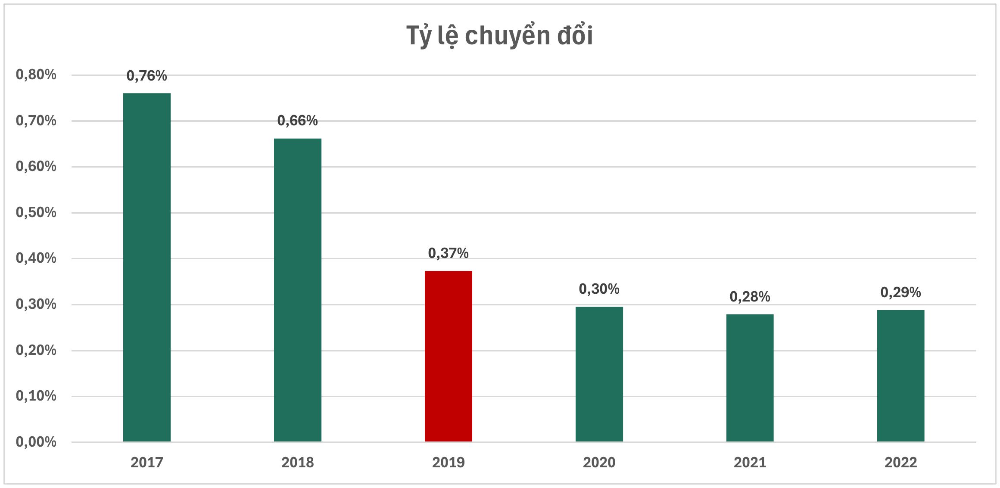

<h1 align="center">Sales Analytics 2017–2022</h1>
<p align="center"><b>Vì sao doanh thu giảm 39% và lợi nhuận đang mất ở đâu?</b></p>

<p align="center">
  
  
  
  
</p>

<p align="center">
  <a href="reports/Sales_Analytics_2017-2022_Report.pdf"><b>Đọc báo cáo đầy đủ (15 trang)</b></a>
  &nbsp;·&nbsp;
  <a href="dashboard/Sales_Analytics_Dashboard.xlsx"><b>Tải dashboard Excel</b></a>
  &nbsp;·&nbsp;
  <a href="data/"><b>Dữ liệu &amp; data dictionary</b></a>
</p>

<p align="center"><sub><i>Bài nộp theo nhóm của khóa học — xem mục <a href="#vai-trò--ghi-nhận">Vai trò &amp; ghi nhận</a>.</i></sub></p>



---

## Kết quả chính

- **Khách vào trang nhiều hơn nhưng ít đặt hàng hơn.** Lượt truy cập **tăng 23%** trong khi tỷ lệ chuyển đổi **giảm 62%** (0,76% → 0,29%), kéo doanh thu **giảm 39%**. Chi thêm tiền quảng cáo không giải quyết được vấn đề này.
- **Toàn bộ tiền lãi đến từ hàng không khuyến mãi** (+940 triệu). Hàng có khuyến mãi **lỗ 323 triệu**; ngưỡng hoà vốn rơi vào khoảng **mức giảm 10%**, từ 12% trở lên đều lỗ.
- **52% tiền hoàn trả** (trong tổng 250 triệu) đến từ đúng hai lý do: **sai size** và **không đúng mô tả** — hai thứ sửa được bằng nội dung trang sản phẩm.

---

## Bối cảnh

Một nhà bán lẻ thời trang bán qua nhiều kênh, khách ở ba miền Đông – Trung – Tây, bốn nhóm hàng (Streetwear, Outdoor, Casual, GenZ). Trong sáu năm 2017–2022 doanh nghiệp thu về gần **6,96 tỷ đồng** doanh thu với biên lợi nhuận gộp **8,87%**, nhưng doanh thu năm sau thấp hơn năm trước ở hầu hết các năm.

Một chi tiết lộ ra ngay từ bước tổng quan: **17 trong 72 tháng bán lỗ, và các tháng lỗ lặp lại theo lịch** — tháng 12 lỗ cả sáu năm, tháng 8 các năm lẻ lỗ 36–41%.



Báo cáo trả lời năm câu hỏi:

| | Câu hỏi |
|---|---|
| **Q1** | Doanh thu thay đổi qua các năm thế nào, lợi nhuận có thay đổi cùng chiều không? |
| **Q2** | Các chương trình khuyến mãi đang làm tăng hay giảm lợi nhuận? |
| **Q3** | Hàng bị trả lại phản ánh vấn đề gì? |
| **Q4** | Với chương trình giảm theo phần trăm, giảm tới mức nào thì hết lãi? |
| **Q5** | Doanh thu giảm có phải vì lượng khách vào trang giảm không? |

---

## Q1. Doanh thu và lợi nhuận qua các năm

**Trả lời.** Hai thứ này **không** đi cùng chiều. Doanh thu giảm gần như liên tục đến 2021 rồi tăng lại 12% năm 2022, trong khi biên lợi nhuận lên xuống xen kẽ và không theo doanh thu.

<table><tr>
<td></td>
<td></td>
</tr></table>

- Năm 2019 doanh thu giảm **39%** so với 2018 — nhưng biên lợi nhuận năm đó vẫn 7,00%.
- Năm có biên thấp nhất lại là 2021 (**5,14%**), khi doanh thu chỉ giảm 2,2%.
- Riêng tháng 8/2021 lỗ 24,7 triệu, bằng **54% lợi nhuận gộp của cả năm**.

**Dẫn tới.** Doanh thu giảm và biên lợi nhuận thấp là hai vấn đề khác nhau, cần truy nguyên nhân riêng — doanh thu ở Q5, biên lợi nhuận ở Q2 và Q4.

<sub>→ Chi tiết trong báo cáo, mục IV.1</sub>

## Q2. Khuyến mãi làm tăng hay giảm lợi nhuận?

**Trả lời.** Trên chính những hàng được giảm giá, khuyến mãi **đang làm giảm** lợi nhuận. Toàn bộ tiền lãi của doanh nghiệp đến từ hàng bán không khuyến mãi.



- Hàng không khuyến mãi: biên **19,7%**. Hàng có khuyến mãi: lỗ **323 triệu**, biên **−14,8%**.
- Trong 31 chương trình có phát sinh đơn, **27 chương trình lỗ**.
- Hàng khuyến mãi được bán bằng 81% giá niêm yết **trước khi** trừ chiết khấu — nên mức giảm thực (27,3%) cao gần gấp đôi mức ghi trên chương trình (14,6%).

**Đề xuất.** Giới hạn mức giảm theo phần trăm ở 10%, dừng các chương trình 18–20%, hạn chế cho cộng dồn khuyến mãi. Áp thử trên một nhóm hàng trước khi áp toàn bộ.

<sub>→ Chi tiết trong báo cáo, mục IV.2</sub>

## Q3. Hàng bị trả lại phản ánh vấn đề gì?

**Trả lời.** Lý do được ghi nhiều nhất là **sai size**. Cộng với "không đúng mô tả", hai lý do này chiếm **52% tiền hoàn**.



- Sáu năm có 47.592 sản phẩm bị trả (3,75% số bán ra), tiền hoàn **250 triệu** — bằng **41% lợi nhuận gộp** cả giai đoạn.
- Sai size 86,2 triệu (35%), lỗi sản phẩm 50,8 triệu (20%), không đúng mô tả 44,9 triệu (18%), đổi ý 44,0 triệu (18%), giao hàng trễ 23,9 triệu (10%).

**Đề xuất.** Cập nhật bảng size, hướng dẫn chọn size và mô tả sản phẩm trên toàn trang; theo dõi tiền hoàn của hai lý do này theo quý. Chi phí thấp, làm được song song với Q2.

<sub>→ Chi tiết trong báo cáo, mục IV.3</sub>

## Q4. Giảm theo phần trăm tới mức nào thì hết lãi?

**Trả lời.** Chỉ mức giảm **10%** còn lãi (biên 0,7%). Từ **12%** trở lên đều lỗ, càng giảm sâu lỗ càng nặng. Ngưỡng hoà vốn tham khảo khoảng **10,3%**.



| Mức giảm ghi | 0% | 10% | 12% | 15% | 18% | 20% |
|---|---:|---:|---:|---:|---:|---:|
| **Biên lợi nhuận** | 19,7% | 0,7% | −3,6% | −7,9% | −19,5% | −24,8% |

- Riêng hai mức 18% và 20% lỗ **181 triệu**, chiếm **88%** toàn bộ số lỗ của loại giảm theo phần trăm.
- Ở mọi mức, khách thực tế trả thấp hơn giá niêm yết nhiều hơn mức ghi khoảng **9–16 điểm phần trăm**.

**Đề xuất.** Con số 10,3% chỉ nên xem là mốc tham khảo ban đầu — chỉ có hai mức nằm gần điểm hoà vốn và mức 15% có rất ít dữ liệu. Để có ngưỡng đáng tin, cần thử nghiệm 10% và 12% trên **cùng một nhóm hàng**.

<sub>→ Chi tiết trong báo cáo, mục IV.4</sub>

## Q5. Doanh thu giảm có phải vì ít khách vào trang?

**Trả lời.** **Không.** Lượt vào trang tăng đều qua các năm. Doanh thu giảm vì tỷ lệ chuyển đổi sụt mạnh, tập trung vào năm 2019.

Phân rã doanh thu thành ba yếu tố nhân nhau:

```
Doanh thu  =  Lượt truy cập  ×  Tỷ lệ chuyển đổi  ×  Giá trị đơn trung bình
  −39,4%         +23,0%              −62,1%                 +30,0%
```

<table><tr>
<td></td>
<td></td>
</tr></table>

Hai yếu tố tăng không bù nổi một yếu tố giảm. Riêng năm 2019, lượt truy cập vẫn tăng 6% nhưng số đơn rơi từ 62.342 xuống 37.290 — tỷ lệ chuyển đổi giảm 44%, kéo doanh thu xuống **45,2 điểm phần trăm**, lớn hơn cả mức giảm 39,0% của năm đó.

Tỷ lệ chuyển đổi giảm ở **cả sáu nguồn truy cập**, và nguồn nào cũng giảm mạnh nhất vào 2019.

**Đề xuất.** Vì mọi nguồn cùng giảm vào cùng một năm, nguyên nhân nhiều khả năng nằm ở một yếu tố ảnh hưởng đến mọi khách — giá bán, giao diện trang, tồn kho hoặc danh mục sản phẩm. **Chưa tăng ngân sách quảng cáo** cho đến khi tìm được nguyên nhân.

<sub>→ Chi tiết trong báo cáo, mục IV.5 và Phụ lục E</sub>

---

<details>
<summary><b>Phương pháp, làm sạch dữ liệu và mô hình</b> — bấm để mở</summary>

### Ba quyết định làm thay đổi con số

| Quyết định | Tác động |
|---|---|
| Loại 30.692 đơn `cancelled` / `created` (10,5% số đơn) | Doanh thu sáu năm 6,96 tỷ thay vì 7,78 tỷ. Vẫn giữ 16.240 đơn bị trả vì đó là đơn đã bán. |
| Giữ 59,8% dòng hàng không có mã khuyến mãi, gắn nhãn `Không khuyến mãi` | Tạo nhóm đối chứng cho Q2 và Q4 |
| Tính tiền hoàn theo **ngày đặt của đơn gốc** | Tỷ lệ trả hàng mỗi năm so trên cùng một nhóm đơn |

**Thứ tự thao tác quan trọng.** Phải loại đơn trước, loại dòng hàng sau. Nếu giữ 33.132 dòng hàng mồ côi, tổng doanh thu và tổng theo tháng lệch nhau **824 triệu**.

Sau xử lý, các con số tổng khớp với số tham chiếu của đề bài: doanh thu 6.955.621.865 · biên 8,87% · 261.839 đơn.

### Mô hình dữ liệu

11 bảng nối qua 12 quan hệ trong Power Pivot. Bảng lịch `DimDate` (01/01/2017–31/12/2022) làm cầu nối giữa dữ liệu đơn hàng và hai bảng tổng hợp theo ngày (`web_traffic`, `sales`). Xem [sơ đồ quan hệ đầy đủ](data/README.md#sơ-đồ-quan-hệ).

### Một vài measure DAX

```dax
Doanh thu gộp   := SUMX(OrderItems_Clean, OrderItems_Clean[quantity] * OrderItems_Clean[unit_price])
Giá vốn         := SUMX(OrderItems_Clean, OrderItems_Clean[quantity] * RELATED(Products_Clean[unit_cogs]))
Doanh thu thuần := [Doanh thu gộp] - [Chiết khấu]
Biên lợi nhuận  := DIVIDE([Lợi nhuận gộp], [Doanh thu thuần])
Tỷ lệ chuyển đổi := DIVIDE([Số đơn], [Lượt truy cập])

Doanh thu năm trước  := CALCULATE([Doanh thu thuần], SAMEPERIODLASTYEAR(DimDate[Date]))
Tăng trưởng theo năm := IF(HASONEVALUE(DimDate[Năm]),
                           DIVIDE([Doanh thu thuần] - [Doanh thu năm trước], [Doanh thu năm trước]))
```

`HASONEVALUE` để trống ô tăng trưởng ở dòng tổng, vì tăng trưởng chỉ có nghĩa khi so hai năm cụ thể.

### Dashboard

Sáu ô chỉ số tổng, bốn bộ lọc (năm, nhóm hàng, miền, nhóm kênh), biểu đồ cho cả Q1–Q5. Khi có dữ liệu mới chỉ cần thay file nguồn và **Refresh All**, toàn bộ chỉ số tự tính lại.

</details>

---

## Hạn chế đã biết

Những điểm dưới đây giới hạn mức độ tin cậy của kết luận. Phần nào là số liệu chắc chắn, phần nào là suy luận cần kiểm chứng đều được ghi rõ trong báo cáo.

1. **Giá niêm yết trong dữ liệu là giá hiện tại.** Mức giảm thực ở Q2/Q4 và con số "bán bằng 81% giá niêm yết" đều so với giá hiện tại. Nếu giá niêm yết từng thay đổi trong sáu năm, các con số này sẽ khác — và chưa có căn cứ để nói chúng lớn hơn hay nhỏ hơn.
2. **Nguồn truy cập được ghi theo ngày**, mỗi ngày gắn một nguồn duy nhất, trong khi đơn hàng ghi nguồn theo từng đơn. Vì vậy tỷ lệ chuyển đổi **theo từng nguồn** ở Q5 chỉ là ước tính. Tỷ lệ chuyển đổi chung theo năm không bị ảnh hưởng.
3. **Chưa có nhóm đối chứng cho khuyến mãi.** Q2 và Q4 chỉ đo lãi lỗ trên các dòng hàng được giảm giá, chưa đo được khuyến mãi có kéo thêm khách mới hay làm khách mua thêm hàng khác hay không.
4. **Chưa biết nguyên nhân tỷ lệ chuyển đổi giảm năm 2019.** Dữ liệu cho biết thời điểm và mức độ, nhưng không có thông tin về giá đối thủ, tồn kho hay thay đổi trên website.
5. **Lợi nhuận trong báo cáo là lợi nhuận gộp**, chưa trừ chi phí vận chuyển, marketing và xử lý trả hàng. Ngoài ra bảng doanh thu theo ngày của đề bài cho số cao hơn doanh thu tính từ đơn hàng khoảng 17–18% mỗi năm; hai nguồn này chưa đối soát được nên chỉ dùng doanh thu tính từ đơn hàng.

---

## Cấu trúc repo

```
sales-analytics-excel/
├── README.md
├── reports/
│   └── Sales_Analytics_2017-2022_Report.pdf    báo cáo đầy đủ, 15 trang
├── dashboard/
│   └── Sales_Analytics_Dashboard.xlsx          mô hình dữ liệu + measure + dashboard
├── figures/                                    9 biểu đồ dùng trong README
└── data/
    ├── README.md                               data dictionary + sơ đồ quan hệ
    └── sample/                                 9 bảng, mỗi bảng 500 dòng đầu
```

---

## Vai trò & ghi nhận

Bài được nộp dưới tên nhóm 5 thành viên theo quy định của khóa học eDA Conquer 2026. Toàn bộ nội dung kỹ thuật trong repo này — làm sạch dữ liệu, mô hình dữ liệu Power Pivot, bộ measure DAX, dashboard, phân tích Q1–Q5 và soạn thảo báo cáo — do tôi trực tiếp thực hiện.

---

## Nguồn dữ liệu & giấy phép

Bộ dữ liệu thuộc về **AI VIETNAM – End-to-End Data Analytics (eDA Conquer 2026)**. Dữ liệu đã được ẩn danh và quy đổi về một đơn vị tiền quy ước, không phải số liệu thật của doanh nghiệp nào. Repo này chỉ chứa **mẫu 500 dòng mỗi bảng**; bộ đầy đủ không được đăng lại tại đây. Trang khóa học: <https://eda.aivietnam.edu.vn/>

Phần phân tích, dashboard và tài liệu do tôi viết được phát hành theo giấy phép [MIT](LICENSE).
